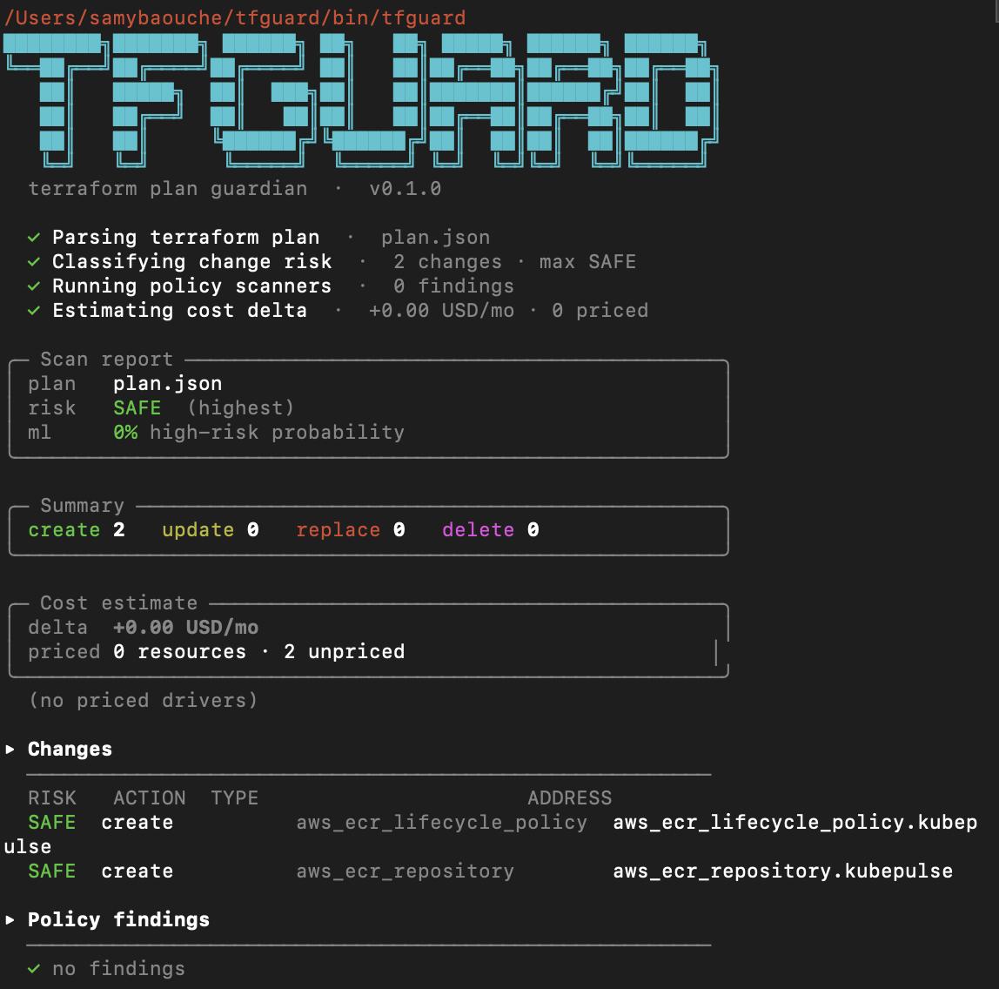
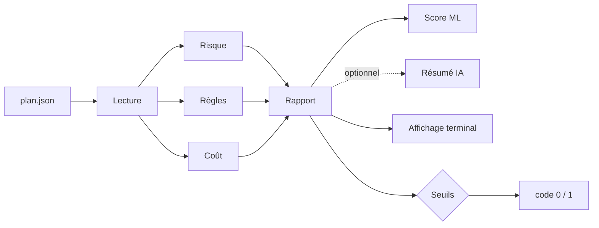

# tfguard

**Un relecteur Terraform pour AWS, à lancer avant `apply`.** tfguard lit le JSON d'un `terraform plan`, évalue le risque de chaque changement, applique des règles de sécurité, estime l'écart de coût mensuel et fait échouer la CI quand un seuil est atteint — sans aucun identifiant cloud.

[](https://github.com/SamyBaouche/tfguard/actions/workflows/ci.yml)
[](https://github.com/SamyBaouche/tfguard/releases/tag/v0.1.0)
[](https://go.dev/)
[](https://www.terraform.io/)
[](https://www.openpolicyagent.org/)
[](LICENSE)

> Lire en [English](README.md) · **Français**

## Sommaire

1. [Présentation](#1-présentation)
2. [Démarrage rapide](#2-démarrage-rapide)
3. [Utilisation](#3-utilisation)
4. [Fonctionnement](#4-fonctionnement)
5. [Ce que tfguard vérifie](#5-ce-que-tfguard-vérifie)
6. [Intégration CI/CD](#6-intégration-cicd)
7. [Développement](#7-développement)
8. [Conception et limites](#8-conception-et-limites)
9. [Feuille de route](#9-feuille-de-route)
10. [Contribution et licence](#10-contribution-et-licence)

---

## 1. Présentation

Un `terraform plan` réussi n'est pas un changement sûr. Les gros diffs cachent une base de données supprimée, un security group ouvert ou un redimensionnement coûteux. tfguard relit le plan **avant `apply`** et répond à cinq questions :

| Question | Réponse de tfguard |
|---|---|
| Quel est le risque de chaque changement ? | Un niveau de `SAFE` à `CRITICAL`, plus élevé pour les ressources qui stockent des données |
| Est-ce sécurisé ? | Règles OPA/Rego intégrées, plus Checkov et tfsec s'ils sont installés |
| Combien ça va coûter ? | Écart mensuel estimé en USD et principales sources de coût |
| Quel est le risque global du plan ? | Probabilité de risque élevé calculée par machine learning |
| La CI doit-elle bloquer ? | Code de sortie `1` quand `--fail-on` ou `--max-cost-increase` est atteint |

Un LLM local optionnel (Ollama) peut aussi résumer le rapport en langage simple.

tfguard **ne déploie jamais** rien : il lit seulement le fichier du plan.



---

## 2. Démarrage rapide

### Installation

| Méthode | Commande |
|---|---|
| Depuis les sources (Go 1.26+) | `git clone https://github.com/SamyBaouche/tfguard.git && cd tfguard && make build` |
| `go install` | `go install github.com/SamyBaouche/tfguard/cmd/tfguard@latest` |
| Binaire précompilé | À télécharger dans [Releases v0.1.0](https://github.com/SamyBaouche/tfguard/releases/tag/v0.1.0) (Linux, macOS, Windows · amd64, arm64) |

### Essayer sur un plan d'exemple

```bash
./bin/tfguard scan --plan testdata/plan_mixed.json --no-ai
```

### Scanner ta propre infrastructure

À lancer dans ton projet Terraform :

```bash
terraform init
terraform plan -out=plan.tfplan
terraform show -json plan.tfplan > plan.json

tfguard scan --plan plan.json --dir . --fail-on DANGER
```

### Outils optionnels

| Outil | Sert à | S'il manque |
|---|---|---|
| Checkov | Règles supplémentaires sur les fichiers `.tf` (`--dir`) | Avertissement, le scan continue |
| tfsec | Contrôles de sécurité supplémentaires sur les fichiers `.tf` (`--dir`) | Avertissement, le scan continue |
| Ollama | Résumé IA | Avertissement, le scan continue |

---

## 3. Utilisation

### Commandes

```bash
tfguard scan --plan <plan.json> [options]   # relire un plan
tfguard version                             # afficher la version
```

### Options

| Option | Défaut | Description |
|---|---|---|
| `--plan` | — | Fichier JSON du plan (**obligatoire**) |
| `--dir` | — | Dossier des sources Terraform ; active Checkov et tfsec |
| `--fail-on` | désactivé | Code `1` à partir de `SAFE`, `CAUTION`, `DANGER` ou `CRITICAL` |
| `--max-cost-increase` | désactivé | Code `1` si la hausse du coût mensuel dépasse ce montant en USD |
| `--no-ai` | `false` | Désactiver le résumé IA (recommandé en CI) |
| `--ollama-url` | `http://127.0.0.1:11434` | Adresse d'Ollama |
| `--ollama-model` | `llama3.2` | Modèle Ollama |
| `--skip-opa` / `--skip-checkov` / `--skip-tfsec` / `--skip-cost` | `false` | Désactiver une étape |
| `--no-banner` | `false` | Masquer la bannière de démarrage |

Définis `NO_COLOR=1` pour une sortie sans couleurs.

### Codes de sortie

| Code | Signification |
|---|---|
| `0` | Scan terminé, aucun seuil atteint |
| `1` | Un seuil a été atteint, ou une erreur est survenue |
| `2` | Mauvaise utilisation (option manquante ou invalide) |

### Exemples

```bash
# Relecture simple
tfguard scan --plan plan.json --no-ai

# Bloquer les suppressions, les remplacements et les findings HIGH
tfguard scan --plan plan.json --fail-on DANGER --no-ai

# Bloquer les changements qui ajoutent plus de 50 $/mois
tfguard scan --plan plan.json --max-cost-increase 50 --no-ai

# Tout activer : scanners HCL et les deux seuils
tfguard scan --plan plan.json --dir ./infra --fail-on CRITICAL --max-cost-increase 100 --no-ai

# Avec le résumé IA
ollama pull llama3.2
tfguard scan --plan plan.json
```

### Exemple de rapport

```text
╭─ Scan report ────────────────────────────────────────────╮
│ plan   testdata/plan_mixed.json                          │
│ risk   CRITICAL  (highest)                               │
│ ml     100% high-risk probability                        │
╰──────────────────────────────────────────────────────────╯

╭─ Summary ────────────────────────────────────────────────╮
│ create 1   update 1   replace 1   delete 1               │
╰──────────────────────────────────────────────────────────╯

╭─ Cost estimate ──────────────────────────────────────────╮
│ delta  +7.59 USD/mo                                      │
│ priced 1 resources · 3 unpriced                          │
╰──────────────────────────────────────────────────────────╯
▸ Top cost drivers
  DELTA  BEFORE  AFTER  ADDRESS
  +7.59  7.59    15.18  aws_instance.web

▸ Changes
  RISK      ACTION   TYPE                ADDRESS
  CRITICAL  delete   aws_db_instance     aws_db_instance.main
  CAUTION   update   aws_instance        aws_instance.web
  CAUTION   create   aws_s3_bucket       aws_s3_bucket.logs
  DANGER    replace  aws_security_group  aws_security_group.web

▸ Policy findings
  ✓ no findings

  ▸  4 changes scanned · 0 policy findings · max risk CRITICAL · cost +7.59 USD/mo
```

---

## 4. Fonctionnement

tfguard enchaîne des étapes simples. Chaque étape est un petit package Go, et `internal/scan` assemble les résultats en un seul rapport.



| Étape | Package | Rôle |
|---|---|---|
| CLI | `cmd/tfguard` | Commandes, options, codes de sortie |
| Orchestration | `internal/scan` | Lance chaque étape et évalue les seuils |
| Lecture | `internal/tfplan` | Lit le plan et compte les create / update / replace / delete |
| Risque | `internal/risk` | Attribue un niveau de risque à chaque changement |
| Règles | `internal/policy` | Lance OPA, Checkov et tfsec, et fusionne leurs findings |
| Coût | `internal/cost` | Estime le coût mensuel avant et après |
| Score ML | `internal/mlscore` | Calcule la probabilité de risque élevé |
| Résumé IA | `internal/explain` | Construit le prompt et vérifie la réponse du LLM |
| Client LLM | `internal/llm` | Parle au LLM local (Ollama) derrière une interface `Provider` |
| Affichage | `internal/render`, `internal/ui` | Rapport coloré dans le terminal |

---

## 5. Ce que tfguard vérifie

### Niveaux de risque

Chaque changement reçoit un niveau selon son action. Si la ressource stocke des données, le niveau monte **d'un cran**.

| Action | Niveau | Niveau pour une ressource qui stocke des données |
|---|---|---|
| create | `SAFE` | `CAUTION` |
| update | `CAUTION` | `DANGER` |
| replace / delete | `DANGER` | `CRITICAL` |

Les ressources qui stockent des données incluent RDS, Aurora, S3, EBS, DynamoDB, EFS, ElastiCache, Redshift, OpenSearch, DocumentDB et Neptune. Le risque global du plan est le niveau le plus élevé trouvé.

### Règles de sécurité

Cinq règles sont intégrées au binaire (`policies/*.rego`) :

| ID | Gravité | Détecte |
|---|---|---|
| `TFGUARD-S3-001` | HIGH | ACL de bucket S3 publique |
| `TFGUARD-SG-001` | CRITICAL | Security group ouvert à `0.0.0.0/0` |
| `TFGUARD-RDS-001` | HIGH | Stockage RDS non chiffré |
| `TFGUARD-IAM-001` | CRITICAL | Politique IAM qui autorise toutes les actions (`*`) |
| `TFGUARD-EBS-001` | HIGH | Volume EBS non chiffré |

Avec `--fail-on`, les findings comptent aussi : `CRITICAL` → `CRITICAL`, `HIGH` → `DANGER`, `MEDIUM` → `CAUTION`.

Pour ajouter une règle, crée `policies/<nom>.rego` avec `package tfguard.<nom>` et une règle `violation` qui renvoie `id`, `severity`, `title`, `description` et `resource`.

### Estimation du coût

tfguard calcule le prix de chaque ressource avant et après le changement, avec des prix fixes `us-east-1` à la demande :

- **Instances** — 28 tailles pour EC2, RDS, ElastiCache, OpenSearch et Redshift
- **Stockage** — RDS et EBS, au Go par mois
- **Ressources à prix fixe** — NAT Gateway, load balancer, Elastic IP

Les services facturés à l'usage, comme S3 et DynamoDB, sont marqués *unpriced* au lieu d'être devinés. Les chiffres aident la relecture ; ce n'est pas une facture.

### Score de risque ML

Un modèle de régression logistique estime la probabilité que le plan soit à risque élevé.

| Élément | Détail |
|---|---|
| Entrées | 10 variables : nombre de changements, changements sur des données, findings, écart de coût |
| Entraînement | `scripts/generate_dataset.py` puis `scripts/train_model.py` |
| Exécution | Poids intégrés au binaire (`internal/mlscore/model.json`) |
| Résultats de test | Précision 1,00 · rappel 0,98 · F1 0,99 ([détails](data/model_metrics.json)) |

> **Note :** le modèle est entraîné sur 250 plans synthétiques dont les étiquettes viennent d'une règle de calcul, et testé sur seulement 50. Ces résultats montrent qu'il a appris cette règle, pas qu'il est précis sur de vrais plans.

### Résumé IA (optionnel)

Quand Ollama tourne en local, tfguard envoie une courte description JSON du scan (jamais tes fichiers `.tf`) et affiche un résumé, les principaux risques, des recommandations et une note sur le coût.

- Les réponses suivent un schéma JSON strict et sont vérifiées avant affichage.
- La température est réglée à 0 : le même scan donne le même résumé.
- Les réponses sont mises en cache sur le disque, avec une clé SHA-256 du scan.
- Si Ollama n'est pas disponible, le rapport s'affiche quand même.
- L'IA ne décide jamais du code de sortie. Utilise `--no-ai` en CI.

---

## 6. Intégration CI/CD

### N'importe quelle CI

Génère le plan, lance tfguard, et laisse son code de sortie valider ou faire échouer le job :

```yaml
- run: |
    terraform plan -out=plan.tfplan
    terraform show -json plan.tfplan > plan.json
    tfguard scan --plan plan.json --dir ./infra --fail-on DANGER --max-cost-increase 50 --no-ai
```

### GitHub Action

`action.yml` compile tfguard, lance le scan et publie le rapport en commentaire de la pull request.

```yaml
name: Terraform review
on: pull_request

permissions:
  contents: read
  pull-requests: write

jobs:
  tfguard:
    runs-on: ubuntu-latest
    steps:
      - uses: actions/checkout@v4
      - uses: actions/setup-go@v5
        with:
          go-version: "1.26.x"
      - uses: hashicorp/setup-terraform@v3

      - working-directory: infra
        run: |
          terraform init
          terraform plan -out=plan.tfplan
          terraform show -json plan.tfplan > ../plan.json

      - uses: ./
        with:
          plan-path: plan.json
          terraform-dir: infra
          fail-on: DANGER
          max-cost-increase: "50"
```

| Entrée | Défaut | Description |
|---|---|---|
| `plan-path` | — | Fichier JSON du plan (**obligatoire**) |
| `terraform-dir` | `""` | Dossier pour Checkov et tfsec |
| `fail-on` | `""` | Seuil de risque |
| `max-cost-increase` | `""` | Limite mensuelle en USD |
| `no-ai` | `"true"` | Désactiver le résumé IA |

---

## 7. Développement

### Commandes

```bash
make build   # compiler bin/tfguard
make test    # lancer les tests avec la couverture
make test-integration  # lancer aussi le vrai Terraform (lent, Terraform requis)
make vet     # analyse statique
make fmt     # formater le code
make clean   # supprimer bin/
```

### Tests

- Les tests unitaires utilisent des fichiers JSON dans `testdata/` ; ils n'appellent jamais Terraform, AWS ni un LLM.
- Les tests d'intégration lancent le vrai `terraform init` et `terraform validate` sur les cas de `testdata/fix/`. Ils sont ignorés sauf si tu passes `-integration` (`make test-integration`).
- Les packages principaux sont presque entièrement couverts : `risk` 100 %, `tfplan` ~98 %, `fix` ~96 % (avec les tests d'intégration), `mlscore` ~93 %.

### Réentraîner le modèle ML

```bash
python3 scripts/generate_dataset.py
python3 scripts/train_model.py
make test
```

Commite ensuite `internal/mlscore/model.json` et `data/model_metrics.json`.

### Publier une version

Pousser un tag `v*` compile et publie les binaires pour 6 plateformes avec GoReleaser :

```bash
git tag v0.2.0 && git push origin v0.2.0
```

### Structure du projet

```text
cmd/tfguard/        point d'entrée de la CLI
internal/
  scan/             pipeline et seuils
  tfplan/           lecture du plan
  risk/             niveaux de risque
  policy/           OPA, Checkov, tfsec
  cost/             estimation du coût
  mlscore/          modèle ML
  explain/          résumé IA
  llm/              client LLM (Ollama)
  fix/              correction automatique par IA (en cours)
  render/, ui/      affichage terminal
policies/           règles Rego
scripts/            données et entraînement ML
data/               données et métriques du modèle
testdata/           fichiers de test (fix/ contient les cas Terraform pour la correction IA)
action.yml          GitHub Action
.goreleaser.yaml    configuration des releases
```

---

## 8. Conception et limites

### Choix de conception

- **Le plan fait foi.** Il montre ce que Terraform va vraiment faire, une fois les variables et modules résolus.
- **Les règles décident, l'IA explique.** Les codes de sortie dépendent seulement des règles et du modèle ML, donc les résultats sont reproductibles.
- **Les outils optionnels ne cassent jamais l'exécution.** Un Checkov, tfsec ou Ollama manquant ajoute seulement un avertissement.
- **Un seul binaire autonome.** Règles et poids du modèle sont intégrés ; ni Python ni serveur OPA nécessaires.
- **IA locale uniquement.** Les données de ton infrastructure ne quittent jamais ta machine.

### Limites

- AWS uniquement. Les autres providers sont lus, mais sans règles de risque spécifiques ni prix.
- Les prix sont des valeurs fixes `us-east-1`.
- Le modèle ML est entraîné sur des données synthétiques.
- La GitHub Action ne fonctionne pour l'instant que dans ce dépôt.

---

## 9. Feuille de route

| Statut | Élément |
|---|---|
| ✅ Fait | Lecture du plan, niveaux de risque, règles, coût, score ML, résumé IA, CLI |
| ✅ Fait | GitHub Action, release v0.1.0 |
| 🚧 En cours | **Correction automatique par IA** : `tfguard fix` répare une config Terraform invalide avec un LLM local, `terraform validate` et le schéma du provider. Déjà fait : client LLM partagé, exécution de `terraform init`/`validate` et lecture des diagnostics |
| 🔜 Prévu | Banc d'essai des corrections IA (taux de réussite, vitesse) |
| 🔜 Prévu | GitHub Action utilisable depuis n'importe quel dépôt |
| 🔜 Prévu | Modèle ML entraîné sur de vrais plans |
| 🔜 Prévu | Plus de prix AWS |

---

## 10. Contribution et licence

Les contributions sont les bienvenues — voir [CONTRIBUTING.md](CONTRIBUTING.md). Avant d'ouvrir une pull request, lance `make test && make vet && make fmt`.

Sous licence Apache 2.0 — voir [LICENSE](LICENSE).
