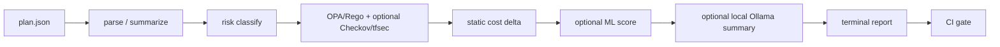

# tfguard

Review Terraform plans before apply — risk, security and cost in one CI gate.

[](https://github.com/SamyBaouche/tfguard/actions/workflows/ci.yml)
[](https://github.com/SamyBaouche/tfguard/releases)
[](https://go.dev/)
[](LICENSE)

> **English** · [Français](README.fr.md)

tfguard is a Go CLI that reads `terraform show -json` output and can fail a pipeline before `terraform apply`. It does not talk to AWS and it does not deploy anything.

## Problem

A successful `terraform plan` is not a safe change. A large plan can hide a delete of a stateful resource (RDS, S3, EBS), a security group open to the internet, a wildcard IAM policy, or a resize that jumps the monthly bill. Reviewing that by eye does not scale. tfguard turns the plan into a report and an exit code so CI can block it.

## Quick start

```bash
terraform plan -out=tfplan.binary
terraform show -json tfplan.binary > plan.json
tfguard scan --plan plan.json --fail-on DANGER --no-ai
```

Exit code `1` means the gate fired. Do not `apply`.

**Install**

| Method | How |
|---|---|
| GitHub release | [Releases](https://github.com/SamyBaouche/tfguard/releases) — GoReleaser builds 6 targets: linux, darwin, and windows, each for amd64 and arm64 |
| From source | `git clone https://github.com/SamyBaouche/tfguard.git && cd tfguard && make build` → `./bin/tfguard` |

Go 1.26+ is required to build from source. Sample plans live in `testdata/` (`plan_mixed.json`, `plan_minimal.json`, `plan_replace.json`).

## How it works



`internal/scan` runs that sequence. The CLI prints the report, then decides the exit code from `--fail-on` and `--max-cost-increase`. The ML score and the LLM summary are display-only.

## Risk model

Each mutating change gets a base level. Stateful types add one level, capped at `CRITICAL`.

| Action | Base level | If stateful |
|---|---|---|
| create / read / no-op | `SAFE` | `CAUTION` |
| update | `CAUTION` | `DANGER` |
| replace / delete | `DANGER` | `CRITICAL` |

Stateful types: RDS (`aws_db_instance`, `aws_rds_cluster`, `aws_rds_cluster_instance`), S3, EBS volume and snapshot, DynamoDB, EFS, ElastiCache, Redshift, OpenSearch / Elasticsearch, DocumentDB, Neptune.

`--fail-on` also looks at policy findings. Severity maps onto the same scale: `CRITICAL` → `CRITICAL`, `HIGH` → `DANGER`, `MEDIUM` → `CAUTION`. Anything else maps to `SAFE`. The process exits `1` when the highest change level or any finding is at or above the threshold.

Deleting `aws_db_instance` is `DANGER`, then escalates to `CRITICAL`.

## Policies

Five Rego policies are compiled into the binary with `go:embed` (`policies/*.rego`). They run on every scan unless `--skip-opa` is set.

| ID | Severity | Catches |
|---|---|---|
| `TFGUARD-S3-001` | HIGH | `aws_s3_bucket` `acl` of `public-read`, `public-read-write`, or `authenticated-read` |
| `TFGUARD-SG-001` | CRITICAL | Ingress from `0.0.0.0/0` on `aws_security_group` or `aws_security_group_rule` |
| `TFGUARD-RDS-001` | HIGH | `aws_db_instance` without `storage_encrypted` |
| `TFGUARD-EBS-001` | HIGH | `aws_ebs_volume` without `encrypted` |
| `TFGUARD-IAM-001` | CRITICAL | IAM policy document containing `"Action":"*"` or `"Action": "*"` |

Checkov and tfsec run only when `--dir` points at a Terraform directory **and** the binary is on `PATH`. A missing binary adds a warning. The scan continues. `--skip-checkov` and `--skip-tfsec` turn them off.

## Cost

Prices are a static us-east-1 on-demand table in `internal/cost`: about 28 instance SKUs (EC2, RDS, ElastiCache, OpenSearch, Redshift), fixed monthly prices for NAT Gateway, ALB, and idle EIP, plus per-GB storage rates for RDS and EBS. For each priced change, tfguard compares before and after and reports a monthly USD delta and the top 3 drivers by absolute delta.

```bash
tfguard scan --plan plan.json --max-cost-increase 50 --no-ai
```

That exits `1` when the monthly delta is **greater than** 50. This is a review signal, not an AWS bill. Usage-based resources (S3, DynamoDB) are left unpriced.

## Exit codes and flags

| Code | Meaning |
|---|---|
| `0` | Scan finished and no gate fired |
| `1` | `--fail-on` or `--max-cost-increase` fired, or a runtime error |
| `2` | Bad usage (missing `--plan`, unknown level, non-numeric cost limit) |

| Flag | Default | Effect |
|---|---|---|
| `--plan` | required | Path to plan JSON |
| `--dir` | empty | Terraform directory for Checkov and tfsec |
| `--fail-on` | off | `SAFE`, `CAUTION`, `DANGER`, or `CRITICAL` |
| `--max-cost-increase` | off | Monthly USD ceiling |
| `--skip-opa` / `--skip-checkov` / `--skip-tfsec` / `--skip-cost` | off | Skip that stage |
| `--no-ai` | off | Skip the Ollama summary. Use this in CI |
| `--ollama-url` | `http://127.0.0.1:11434` | Ollama base URL |
| `--ollama-model` | `llama3.2` | Ollama model |
| `--no-banner` | off | Skip the banner |

`NO_COLOR=1` disables color. Commands: `tfguard scan` and `tfguard version`.

## Optional ML signal

After the deterministic stages, tfguard runs an embedded logistic regression (`internal/mlscore`, coefficients in `model.json` via `go:embed`). Inference is pure Go. Training is offline Python (`scripts/generate_dataset.py`, `scripts/train_model.py`).

The training set is about 250 **synthetic feature vectors**, not real Terraform plans. Labels come from a heuristic on those same features. The probability is printed in the report. It never fails CI.

Treat the number as a lab signal next to the rules, not as a production classifier.

## Optional AI summary

If Ollama is running and `--no-ai` is not set, `internal/explain` sends a compact JSON snapshot of the report and asks for a single JSON object: `summary`, `risks`, `recommendations`, `cost_note`. The response is cached on disk under a SHA-256 of that snapshot.

If Ollama is down, the scan prints a warning and continues. The deterministic gate still owns pass and fail. The LLM cannot clear a `CRITICAL`.

`--no-ai` is the right default in CI. The cache key does not include the model or the prompt, so a model change can return a stale summary until the cache entry is gone.

## CI

Generic job, after `terraform show -json`:

```yaml
- name: tfguard
  run: |
    tfguard scan \
      --plan plan.json \
      --fail-on DANGER \
      --max-cost-increase 100 \
      --no-ai \
      --no-banner
```

A composite action ships in `action.yml` (`plan-path`, `terraform-dir`, `fail-on`, `max-cost-increase`, `no-ai`). It is not reliable yet. Known issues, being fixed:

- The install step runs `go build ./cmd/tfguard` in the **caller** workspace. It should build from `github.action_path`. It also does not install Go.
- The scan is piped to `tee` under `set -o pipefail`. When the gate exits `1`, the comment step is skipped, so the report is missing exactly when it matters.
- Each run calls `issues.createComment`, so a PR accumulates a new comment instead of updating one.

`.github/workflows/ci.yml` only runs `make test` and `make vet` on this repo. It does not scan a plan.

## Real-world usage

Used to review the NeuroOps Terraform plan (ECR repository + lifecycle policy) before apply:


That plan was two `SAFE` creates (`aws_ecr_repository`, `aws_ecr_lifecycle_policy`), no policy findings, and no priced cost delta. ECR is not in the static price table, so both resources show as unpriced.

## Limitations

- `TFGUARD-IAM-001` is a substring match. It misses `["*"]`, `"s3:*"`, and different JSON spacing.
- `TFGUARD-S3-001` checks the inline `acl` attribute only. It does not see `aws_s3_bucket_acl` or a removed public-access block.
- `TFGUARD-SG-001` looks for IPv4 `0.0.0.0/0`. It is not port-aware (443 on a public load balancer is a finding) and it does not cover IPv6 `::/0` or `aws_vpc_security_group_ingress_rule`.
- Cost figures are static us-east-1 guesses, not the AWS Pricing API or Cost Explorer.
- `testdata/` plans are small and hand-written. They are not full `terraform show -json` documents from a real apply.
- There is no `opa test` suite for the Rego policies yet.
- This is a personal project. It has no production adoption to report.

## Roadmap

Not shipped. `internal/fix` can already run `terraform init` (no backend) and `terraform validate` behind a `Runner` interface, and `internal/llm` defines a `Provider`. Neither is a user-facing command, and the fix path does not call a model yet.

- `--format json` for the scan report
- One sticky PR comment instead of a new comment per run
- A GitLab CI example
- Rego tests with `opa test`
- Secret redaction from `after_sensitive` before any LLM call
- Agentic review and fix: propose an HCL change, re-validate, reject a fix that deletes resources to make the plan pass
- A second LLM provider (Bedrock) behind the existing `Provider` interface

## Architecture

| Package | Role |
|---|---|
| `cmd/tfguard` | Cobra CLI, exit codes |
| `internal/tfplan` | Parse plan JSON, collapse replace, summarize mutations |
| `internal/risk` | `SAFE` … `CRITICAL` |
| `internal/policy` | Embedded Rego plus optional Checkov and tfsec |
| `internal/cost` | Static monthly delta and top 3 drivers |
| `internal/mlscore` | Embedded logistic regression |
| `internal/explain` | Optional Ollama summary and SHA-256 cache |
| `internal/llm` | `Provider` interface and Ollama client |
| `internal/fix` | Terraform init/validate runner (not wired to the CLI) |
| `internal/scan` | Pipeline and CI gate |
| `internal/render`, `internal/ui` | Terminal report, banner, color |
| `policies/` | Five `.rego` files, embedded |

## Development

```bash
make build   # bin/tfguard
make test    # go test ./... -cover
make vet     # go vet ./...
make fmt     # go fmt ./...
```

`make test-integration` runs `go test ./internal/fix/ -integration` and needs `terraform` on `PATH`.

## License

Apache 2.0. See [LICENSE](LICENSE).

## Author

[Samy Baouche](https://github.com/SamyBaouche)
