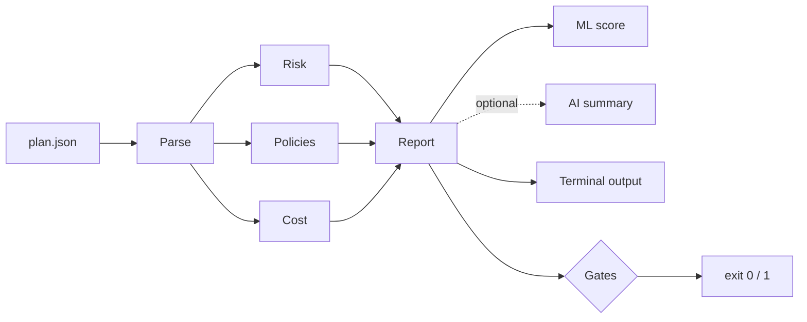

# tfguard

**A pre-apply reviewer for Terraform on AWS.** tfguard reads a `terraform plan` JSON, scores the risk of every change, runs security policies, estimates the monthly cost delta, and fails CI when a threshold is reached — with no cloud credentials.

[](https://github.com/SamyBaouche/tfguard/actions/workflows/ci.yml)
[](https://github.com/SamyBaouche/tfguard/releases/tag/v0.1.0)
[](https://go.dev/)
[](https://www.terraform.io/)
[](https://www.openpolicyagent.org/)
[](LICENSE)

> **English** · Read in [Français](README.fr.md)

## Contents

1. [Overview](#1-overview)
2. [Quick start](#2-quick-start)
3. [Usage](#3-usage)
4. [How it works](#4-how-it-works)
5. [What tfguard checks](#5-what-tfguard-checks)
6. [CI/CD integration](#6-cicd-integration)
7. [Development](#7-development)
8. [Design and limitations](#8-design-and-limitations)
9. [Roadmap](#9-roadmap)
10. [Contributing and license](#10-contributing-and-license)

---

## 1. Overview

A successful `terraform plan` is not a safe change. Large diffs hide a deleted database, an open security group or a costly resize. tfguard reviews the plan **before `apply`** and answers five questions:

| Question | Answer from tfguard |
|---|---|
| How risky is each change? | Level from `SAFE` to `CRITICAL`, higher for data-bearing resources |
| Is it secure? | Built-in OPA/Rego policies, plus Checkov and tfsec if installed |
| What will it cost? | Estimated monthly USD delta and top cost drivers |
| How risky is the plan overall? | Machine-learning high-risk probability |
| Should CI block it? | Exit code `1` when `--fail-on` or `--max-cost-increase` is reached |

An optional local LLM (Ollama) can also summarize the report in plain English.

tfguard **never deploys** anything: it only reads the plan file.

---

## 2. Quick start

### Install

| Method | Command |
|---|---|
| From source (Go 1.26+) | `git clone https://github.com/SamyBaouche/tfguard.git && cd tfguard && make build` |
| `go install` | `go install github.com/SamyBaouche/tfguard/cmd/tfguard@latest` |
| Prebuilt binary | Download from [Releases v0.1.0](https://github.com/SamyBaouche/tfguard/releases/tag/v0.1.0) (Linux, macOS, Windows · amd64, arm64) |

### Try it on a sample plan

```bash
./bin/tfguard scan --plan testdata/plan_mixed.json --no-ai
```

### Scan your own infrastructure

Run this inside your Terraform project:

```bash
terraform init
terraform plan -out=plan.tfplan
terraform show -json plan.tfplan > plan.json

tfguard scan --plan plan.json --dir . --fail-on DANGER
```

### Optional tools

| Tool | Used for | If missing |
|---|---|---|
| Checkov | Extra policy checks on `.tf` files (`--dir`) | Warning, scan continues |
| tfsec | Extra security checks on `.tf` files (`--dir`) | Warning, scan continues |
| Ollama | AI summary | Warning, scan continues |

---

## 3. Usage

### Commands

```bash
tfguard scan --plan <plan.json> [flags]   # review a plan
tfguard version                           # print the version
```

### Flags

| Flag | Default | Description |
|---|---|---|
| `--plan` | — | Plan JSON file (**required**) |
| `--dir` | — | Terraform source folder; enables Checkov and tfsec |
| `--fail-on` | off | Exit `1` at `SAFE`, `CAUTION`, `DANGER` or `CRITICAL` |
| `--max-cost-increase` | off | Exit `1` if the monthly cost increase exceeds this USD value |
| `--no-ai` | `false` | Skip the AI summary (recommended in CI) |
| `--ollama-url` | `http://127.0.0.1:11434` | Ollama address |
| `--ollama-model` | `llama3.2` | Ollama model |
| `--skip-opa` / `--skip-checkov` / `--skip-tfsec` / `--skip-cost` | `false` | Turn off one stage |
| `--no-banner` | `false` | Hide the startup banner |

Set `NO_COLOR=1` for plain output.

### Exit codes

| Code | Meaning |
|---|---|
| `0` | Scan finished, no threshold reached |
| `1` | A threshold was reached, or a runtime error occurred |
| `2` | Invalid usage (missing or wrong flag) |

### Examples

```bash
# Simple review
tfguard scan --plan plan.json --no-ai

# Block deletes, replaces and HIGH findings
tfguard scan --plan plan.json --fail-on DANGER --no-ai

# Block changes that add more than $50/month
tfguard scan --plan plan.json --max-cost-increase 50 --no-ai

# Everything: HCL scanners and both gates
tfguard scan --plan plan.json --dir ./infra --fail-on CRITICAL --max-cost-increase 100 --no-ai

# With the AI summary
ollama pull llama3.2
tfguard scan --plan plan.json
```

### Sample report

```text
╭─ Scan report ────────────────────────────────────────────╮
│ plan   testdata/plan_mixed.json                          │
│ risk   CRITICAL  (highest)                               │
│ ml     100% high-risk probability                        │
╰──────────────────────────────────────────────────────────╯

╭─ Summary ────────────────────────────────────────────────╮
│ create 1   update 1   replace 1   delete 1               │
╰──────────────────────────────────────────────────────────╯

╭─ Cost estimate ──────────────────────────────────────────╮
│ delta  +7.59 USD/mo                                      │
│ priced 1 resources · 3 unpriced                          │
╰──────────────────────────────────────────────────────────╯
▸ Top cost drivers
  DELTA  BEFORE  AFTER  ADDRESS
  +7.59  7.59    15.18  aws_instance.web

▸ Changes
  RISK      ACTION   TYPE                ADDRESS
  CRITICAL  delete   aws_db_instance     aws_db_instance.main
  CAUTION   update   aws_instance        aws_instance.web
  CAUTION   create   aws_s3_bucket       aws_s3_bucket.logs
  DANGER    replace  aws_security_group  aws_security_group.web

▸ Policy findings
  ✓ no findings

  ▸  4 changes scanned · 0 policy findings · max risk CRITICAL · cost +7.59 USD/mo
```

---

## 4. How it works

tfguard runs a simple pipeline. Each step is a small Go package, and `internal/scan` assembles the results into one report.



| Step | Package | What it does |
|---|---|---|
| CLI | `cmd/tfguard` | Commands, flags, exit codes |
| Orchestration | `internal/scan` | Runs every step and evaluates the gates |
| Parse | `internal/tfplan` | Reads the plan and counts create / update / replace / delete |
| Risk | `internal/risk` | Assigns a risk level to each change |
| Policies | `internal/policy` | Runs OPA, Checkov and tfsec, merges their findings |
| Cost | `internal/cost` | Estimates the monthly cost before and after |
| ML score | `internal/mlscore` | Computes the high-risk probability |
| AI summary | `internal/explain` | Asks a local LLM for a plain-English summary |
| Output | `internal/render`, `internal/ui` | Colored terminal report |

---

## 5. What tfguard checks

### Risk levels

Each change gets a level from its action. If the resource stores data, the level goes **one step higher**.

| Action | Level | Level for data-bearing resources |
|---|---|---|
| create | `SAFE` | `CAUTION` |
| update | `CAUTION` | `DANGER` |
| replace / delete | `DANGER` | `CRITICAL` |

Data-bearing resources include RDS, Aurora, S3, EBS, DynamoDB, EFS, ElastiCache, Redshift, OpenSearch, DocumentDB and Neptune. The plan's overall risk is the highest level found.

### Security policies

Five policies are built into the binary (`policies/*.rego`):

| ID | Severity | Detects |
|---|---|---|
| `TFGUARD-S3-001` | HIGH | Public S3 bucket ACL |
| `TFGUARD-SG-001` | CRITICAL | Security group open to `0.0.0.0/0` |
| `TFGUARD-RDS-001` | HIGH | Unencrypted RDS storage |
| `TFGUARD-IAM-001` | CRITICAL | IAM policy allowing every action (`*`) |
| `TFGUARD-EBS-001` | HIGH | Unencrypted EBS volume |

With `--fail-on`, findings count too: `CRITICAL` → `CRITICAL`, `HIGH` → `DANGER`, `MEDIUM` → `CAUTION`.

To add a policy, create `policies/<name>.rego` with `package tfguard.<name>` and a `violation` rule returning `id`, `severity`, `title`, `description` and `resource`.

### Cost estimate

tfguard prices each resource before and after the change, using static `us-east-1` on-demand prices:

- **Instances** — 28 sizes across EC2, RDS, ElastiCache, OpenSearch and Redshift
- **Storage** — RDS and EBS, per GB per month
- **Fixed-price resources** — NAT Gateway, load balancer, Elastic IP

Usage-based services such as S3 and DynamoDB are marked *unpriced* rather than guessed. The numbers help a review; they are not a bill.

### ML risk score

A logistic regression model estimates the probability that the plan is high-risk.

| Item | Detail |
|---|---|
| Inputs | 10 features: change counts, data-bearing changes, findings, cost delta |
| Training | `scripts/generate_dataset.py` then `scripts/train_model.py` |
| Runtime | Weights embedded in the binary (`internal/mlscore/model.json`) |
| Test results | Precision 1.00 · recall 0.98 · F1 0.99 ([details](data/model_metrics.json)) |

> **Note:** the model is trained on 250 synthetic plans whose labels come from a scoring rule, and tested on only 50. These results show it learned that rule, not that it is accurate on real plans.

### AI summary (optional)

When Ollama runs locally, tfguard sends a short JSON description of the scan (never your `.tf` files) and shows a summary, key risks, recommendations and a cost note.

- Answers follow a strict JSON schema and are checked before display.
- Answers are cached on disk, keyed by a SHA-256 hash of the scan.
- If Ollama is not available, the report is still shown.
- The AI never decides the exit code. Use `--no-ai` in CI.

---

## 6. CI/CD integration

### Any CI system

Generate the plan, run tfguard, and let its exit code pass or fail the job:

```yaml
- run: |
    terraform plan -out=plan.tfplan
    terraform show -json plan.tfplan > plan.json
    tfguard scan --plan plan.json --dir ./infra --fail-on DANGER --max-cost-increase 50 --no-ai
```

### GitHub Action

`action.yml` builds tfguard, runs the scan and posts the report as a pull request comment.

```yaml
name: Terraform review
on: pull_request

permissions:
  contents: read
  pull-requests: write

jobs:
  tfguard:
    runs-on: ubuntu-latest
    steps:
      - uses: actions/checkout@v4
      - uses: actions/setup-go@v5
        with:
          go-version: "1.26.x"
      - uses: hashicorp/setup-terraform@v3

      - working-directory: infra
        run: |
          terraform init
          terraform plan -out=plan.tfplan
          terraform show -json plan.tfplan > ../plan.json

      - uses: ./
        with:
          plan-path: plan.json
          terraform-dir: infra
          fail-on: DANGER
          max-cost-increase: "50"
```

| Input | Default | Description |
|---|---|---|
| `plan-path` | — | Plan JSON file (**required**) |
| `terraform-dir` | `""` | Folder for Checkov and tfsec |
| `fail-on` | `""` | Risk threshold |
| `max-cost-increase` | `""` | Monthly USD limit |
| `no-ai` | `"true"` | Skip the AI summary |

---

## 7. Development

### Commands

```bash
make build   # build bin/tfguard
make test    # run tests with coverage
make vet     # static checks
make fmt     # format code
make clean   # remove bin/
```

### Testing

- Unit tests use JSON fixtures in `testdata/`; they never call Terraform, AWS or an LLM.
- Core packages are almost fully covered: `risk` 100%, `tfplan` ~98%, `mlscore` ~93%.

### Retrain the ML model

```bash
python3 scripts/generate_dataset.py
python3 scripts/train_model.py
make test
```

Commit the updated `internal/mlscore/model.json` and `data/model_metrics.json`.

### Release

Pushing a `v*` tag builds and publishes binaries for 6 platforms with GoReleaser:

```bash
git tag v0.2.0 && git push origin v0.2.0
```

### Project structure

```text
cmd/tfguard/        CLI entrypoint
internal/
  scan/             pipeline and gates
  tfplan/           plan parsing
  risk/             risk levels
  policy/           OPA, Checkov, tfsec
  cost/             cost estimate
  mlscore/          ML model
  explain/          AI summary
  render/, ui/      terminal output
policies/           Rego policies
scripts/            ML dataset and training
data/               dataset and model metrics
testdata/           test fixtures (fix/ holds Terraform cases for the AI fix feature)
action.yml          GitHub Action
.goreleaser.yaml    release configuration
```

---

## 8. Design and limitations

### Design choices

- **The plan is the source of truth.** It shows what Terraform will really do, after variables and modules are resolved.
- **Rules decide, AI explains.** Exit codes depend only on rules and the ML model, so results are repeatable.
- **Optional tools never break the run.** A missing Checkov, tfsec or Ollama only adds a warning.
- **One self-contained binary.** Policies and model weights are embedded; no Python or OPA server needed.
- **Local AI only.** Your infrastructure data never leaves your machine.

### Limitations

- AWS only. Other providers are read but get no special risk rules or pricing.
- Prices are fixed `us-east-1` values.
- The ML model is trained on synthetic data.
- The GitHub Action currently works only inside this repository.

---

## 9. Roadmap

| Status | Item |
|---|---|
| ✅ Done | Plan parsing, risk levels, policies, cost, ML score, AI summary, CLI |
| ✅ Done | GitHub Action, v0.1.0 release |
| 🚧 In progress | **AI auto-fix**: `tfguard fix` repairs invalid Terraform using a local LLM, `terraform validate` and the provider schema |
| 🔜 Planned | Benchmark for AI fixes (success rate, speed) |
| 🔜 Planned | GitHub Action usable from any repository |
| 🔜 Planned | ML model trained on real plans |
| 🔜 Planned | More AWS prices |

---

## 10. Contributing and license

Contributions are welcome — see [CONTRIBUTING.md](CONTRIBUTING.md). Before opening a pull request, run `make test && make vet && make fmt`.

Licensed under Apache 2.0 — see [LICENSE](LICENSE).
