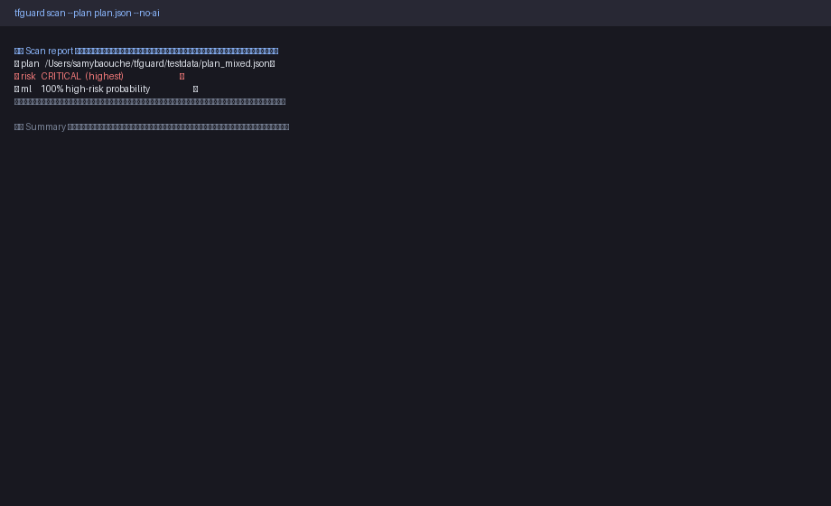
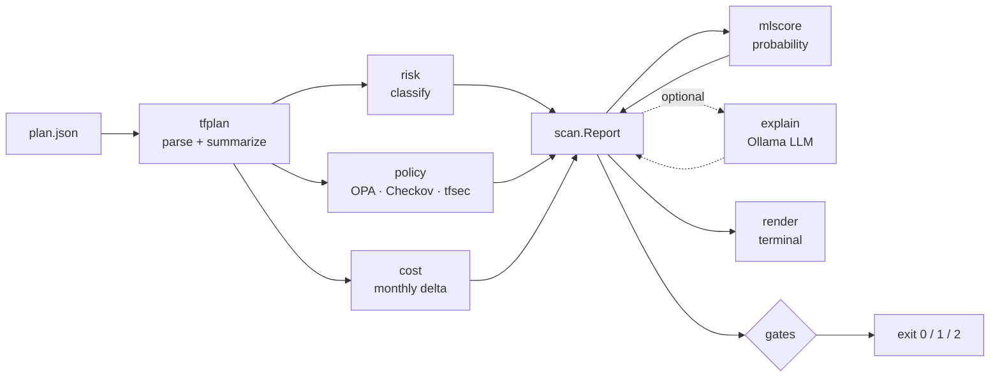

# tfguard

**A pre-apply reviewer for Terraform on AWS.** tfguard reads a `terraform plan` JSON, scores the blast radius of every change, runs security policies, estimates the monthly cost delta, and returns a CI-friendly exit code — with no cloud credentials, and in under a second for the built-in checks.

[](https://github.com/SamyBaouche/tfguard/actions/workflows/ci.yml)
[](https://go.dev/)
[](https://www.terraform.io/)
[](https://www.openpolicyagent.org/)
[](LICENSE)

**Language:** English | [Français](README.fr.md)



---

## Table of contents

- [Why tfguard](#why-tfguard)
- [Features](#features)
- [Quick start](#quick-start)
- [Installation](#installation)
- [Usage](#usage)
- [Architecture](#architecture)
- [Risk model](#risk-model)
- [Security policies](#security-policies)
- [Cost estimation](#cost-estimation)
- [ML risk score](#ml-risk-score)
- [AI explainer](#ai-explainer)
- [CI/CD integration](#cicd-integration)
- [Development](#development)
- [Project layout](#project-layout)
- [Design decisions](#design-decisions)
- [Limitations](#limitations)
- [Roadmap](#roadmap)
- [Contributing](#contributing)
- [License](#license)

---

## Why tfguard

A green `terraform plan` is not a review. In a 200-line diff it is easy to miss that a database is being **deleted**, a security group is being **replaced**, or an instance resize adds **$100/month**. Those mistakes are cheap to catch before `apply` and expensive after.

tfguard turns the plan into a structured, opinionated report and a deterministic exit code, so the same checks run on a laptop and as a required CI gate.

| Question a reviewer asks | How tfguard answers it |
|---|---|
| What is actually changing? | Collapses Terraform actions into `create / update / replace / delete` |
| Could this lose data? | Escalates risk for stateful AWS resources (RDS, S3, EBS, DynamoDB, …) |
| Is it secure? | Embedded OPA/Rego policies, plus Checkov and tfsec when installed |
| What will it cost? | Static monthly USD delta with the top cost drivers |
| Should CI block it? | `--fail-on` and `--max-cost-increase` gates with stable exit codes |

## Features

- **Plan parsing** — decodes `terraform show -json` output; ignores data sources, reads and no-ops.
- **Risk classification** — four levels (`SAFE`, `CAUTION`, `DANGER`, `CRITICAL`) with stateful-resource escalation.
- **Policy as code** — five Rego policies compiled into the binary; optional Checkov and tfsec integration normalized into one finding model.
- **Cost delta** — static `us-east-1` on-demand pricing for 28 instance sizes plus storage and flat-rate resources across EC2, RDS, ElastiCache, OpenSearch, Redshift, EBS, NAT Gateway, ALB and EIP.
- **ML risk score** — embedded logistic regression producing a high-risk probability per plan.
- **AI explainer** — optional plain-English summary from a **local** LLM via Ollama, with structured JSON output and an on-disk cache.
- **CI gates** — `--fail-on` (risk or finding severity) and `--max-cost-increase` (USD/month).
- **Zero cloud access** — works entirely from the plan file; no AWS credentials required.
- **Single static binary** — Linux, macOS and Windows on amd64 and arm64.

## Quick start

```bash
git clone https://github.com/SamyBaouche/tfguard.git
cd tfguard
make build

./bin/tfguard scan --plan testdata/plan_mixed.json --no-ai
```

To scan your own infrastructure:

```bash
terraform plan -out=tfplan
terraform show -json tfplan > plan.json
tfguard scan --plan plan.json --dir . --fail-on DANGER
```

## Installation

| Method | Command |
|---|---|
| From source | `make build` (binary in `bin/tfguard`) |
| `go install` | `go install github.com/SamyBaouche/tfguard/cmd/tfguard@latest` |
| Prebuilt binaries | Published on [GitHub Releases](https://github.com/SamyBaouche/tfguard/releases) for `v*` tags |

**Requirements**

| Dependency | Required | Purpose |
|---|---|---|
| Go 1.26+ | To build | Compile the CLI |
| Terraform | To produce plans | `terraform show -json` |
| [Checkov](https://www.checkov.io/) | Optional | Extra HCL policy checks (`--dir`) |
| [tfsec](https://github.com/aquasecurity/tfsec) | Optional | Extra HCL policy checks (`--dir`) |
| [Ollama](https://ollama.com/) | Optional | Local LLM for the AI explainer |

Missing optional tools produce a **warning**, never a failure.

## Usage

```text
tfguard scan --plan <plan.json> [flags]
tfguard version
```

### Flags

| Flag | Default | Description |
|---|---|---|
| `--plan` | — | Path to the plan JSON (**required**) |
| `--dir` | — | Terraform source directory; enables Checkov and tfsec |
| `--fail-on` | off | Exit `1` at or above `SAFE` \| `CAUTION` \| `DANGER` \| `CRITICAL` |
| `--max-cost-increase` | off | Exit `1` when the monthly cost delta exceeds this USD value |
| `--skip-opa` | `false` | Disable embedded Rego policies |
| `--skip-checkov` | `false` | Disable Checkov |
| `--skip-tfsec` | `false` | Disable tfsec |
| `--skip-cost` | `false` | Disable cost estimation |
| `--no-ai` | `false` | Disable the Ollama explainer (recommended in CI) |
| `--ollama-url` | `http://127.0.0.1:11434` | Ollama endpoint |
| `--ollama-model` | `llama3.2` | Ollama model |
| `--no-banner` | `false` | Skip the animated banner |

### Exit codes

| Code | Meaning |
|---|---|
| `0` | Scan completed; no gate triggered |
| `1` | A gate triggered (`--fail-on`, `--max-cost-increase`) or a runtime error occurred |
| `2` | Usage error (missing or invalid flag, unknown command) |

### Examples

```bash
# Review a plan
tfguard scan --plan plan.json

# Block on destructive changes or HIGH+ findings, including Checkov/tfsec
tfguard scan --plan plan.json --dir ./infra --fail-on DANGER

# Block when the change adds more than $50/month
tfguard scan --plan plan.json --max-cost-increase 50

# CI mode: deterministic, no LLM, no colors
NO_COLOR=1 tfguard scan --plan plan.json --no-ai --no-banner --fail-on CRITICAL
```

### Sample output

```text
╭─ Scan report ────────────────────────────────────────────╮
│ plan   testdata/plan_mixed.json                          │
│ risk   CRITICAL  (highest)                               │
│ ml     100% high-risk probability                        │
╰──────────────────────────────────────────────────────────╯

╭─ Summary ────────────────────────────────────────────────╮
│ create 1   update 1   replace 1   delete 1               │
╰──────────────────────────────────────────────────────────╯

╭─ Cost estimate ──────────────────────────────────────────╮
│ delta  +7.59 USD/mo                                      │
│ priced 1 resources · 3 unpriced                          │
╰──────────────────────────────────────────────────────────╯
▸ Top cost drivers
  DELTA  BEFORE  AFTER  ADDRESS
  +7.59  7.59    15.18  aws_instance.web

▸ Changes
  RISK      ACTION   TYPE                ADDRESS
  CRITICAL  delete   aws_db_instance     aws_db_instance.main
  CAUTION   update   aws_instance        aws_instance.web
  CAUTION   create   aws_s3_bucket       aws_s3_bucket.logs
  DANGER    replace  aws_security_group  aws_security_group.web

▸ Policy findings
  ✓ no findings

  ▸  4 changes scanned · 0 policy findings · max risk CRITICAL · cost +7.59 USD/mo
```

Colors are enabled on a TTY and disabled when output is piped or `NO_COLOR` is set.

## Architecture

tfguard is a linear pipeline. Each stage is a small package with a single responsibility, and `internal/scan` composes them into one `Report`.



| Layer | Package | Responsibility |
|---|---|---|
| CLI | `cmd/tfguard` | Cobra commands, flags, exit-code mapping |
| Orchestration | `internal/scan` | Runs the pipeline, builds `Report`, evaluates gates |
| Parsing | `internal/tfplan` | Typed plan model; collapses actions; sorted summary |
| Risk | `internal/risk` | Action → level; stateful escalation |
| Policy | `internal/policy` | Embedded OPA + optional Checkov/tfsec → unified `Finding` |
| Cost | `internal/cost` | Static price tables; per-resource before/after delta |
| ML | `internal/mlscore` | Embedded logistic regression inference |
| AI | `internal/explain` | Prompt, Ollama client, JSON schema, SHA-256 cache |
| Output | `internal/render`, `internal/ui` | Terminal report, colors, spinner, banner |
| Policies | `policies/` | Rego sources embedded with `go:embed` |

## Risk model

Each mutating change gets a base level from its action, then **escalates by one level** if the resource holds durable data.

| Action | Base level | Stateful resource |
|---|---|---|
| `create` | `SAFE` | `CAUTION` |
| `update` | `CAUTION` | `DANGER` |
| `replace` / `delete` | `DANGER` | `CRITICAL` |

**Stateful types:** `aws_db_instance`, `aws_rds_cluster`, `aws_rds_cluster_instance`, `aws_s3_bucket`, `aws_ebs_volume`, `aws_ebs_snapshot`, `aws_dynamodb_table`, `aws_efs_file_system`, `aws_elasticache_cluster`, `aws_elasticache_replication_group`, `aws_redshift_cluster`, `aws_opensearch_domain`, `aws_elasticsearch_domain`, `aws_docdb_cluster`, `aws_neptune_cluster`.

The plan's overall risk is the highest level across all changes.

## Security policies

Built-in Rego policies (`policies/*.rego`) are evaluated against the plan's `after` values.

| ID | Severity | Detects |
|---|---|---|
| `TFGUARD-S3-001` | HIGH | S3 bucket ACL allows public access |
| `TFGUARD-SG-001` | CRITICAL | Security group (or rule) open to `0.0.0.0/0` |
| `TFGUARD-RDS-001` | HIGH | RDS instance without `storage_encrypted` |
| `TFGUARD-IAM-001` | CRITICAL | IAM policy with `Action: "*"` |
| `TFGUARD-EBS-001` | HIGH | Unencrypted EBS volume |

When `--dir` is set, Checkov and tfsec run on the HCL sources and their results are merged into the same `Finding` model.

**Gate mapping.** `--fail-on` evaluates change risk **and** finding severity on one scale:

| Finding severity | Equivalent risk level |
|---|---|
| `CRITICAL` | `CRITICAL` |
| `HIGH` | `DANGER` |
| `MEDIUM` | `CAUTION` |
| `LOW` / unknown | `SAFE` |

**Adding a policy.** Drop a `.rego` file in `policies/` under a `package tfguard.<name>` that defines `violation contains finding` with `id`, `severity`, `title`, `description` and `resource`. It is embedded and evaluated automatically.

## Cost estimation

For each change, tfguard prices the `before` and `after` attribute sets and reports the difference.

- **Instance SKUs** — `instance_type`, `instance_class` or `node_type` against a static price table (×node count for ElastiCache and Redshift).
- **Storage** — `allocated_storage` (RDS) and `size` (EBS) at a per-GB-month rate.
- **Flat-rate resources** — NAT Gateway, ALB, Elastic IP.
- **Usage-driven services** (S3, DynamoDB, …) are counted as *unpriced* rather than guessed.

The report shows the total delta and the top three drivers by absolute impact. Prices are `us-east-1` on-demand at ~730 h/month: this is a review signal, not a billing forecast.

## ML risk score

A logistic regression model gives a **probability that the plan is high-risk**, complementing the rule-based levels.

| | |
|---|---|
| Features (10) | creates, updates, replaces, deletes, stateful mutations, critical findings, high findings, cost delta, max action level, change count |
| Training | `scripts/generate_dataset.py` (250 synthetic labeled plans, seed 42) → `scripts/train_model.py` (stdlib gradient descent, 80/20 split) |
| Serving | Coefficients exported to `internal/mlscore/model.json` and embedded in the binary — no Python at runtime |
| Hold-out metrics | precision **1.00** · recall **0.98** · F1 **0.99** ([`data/model_metrics.json`](data/model_metrics.json)) |

> **Caveat.** Labels are produced by a weighted heuristic over the same features, and the hold-out set is small (50 plans, 5 negatives). The metrics show the model reproduces the heuristic; they are not evidence of real-world accuracy. Training on labeled production plans is on the roadmap.

## AI explainer

When Ollama is reachable, tfguard sends a compact JSON snapshot of the scan (changes, findings, cost drivers — not your HCL) to a **local** model and renders:

- a 2–3 sentence summary,
- key risks,
- recommended next steps,
- a cost note.

**How it works**

1. The scan context is serialized and hashed with SHA-256.
2. A cached answer is reused from the user cache directory (`<cache>/tfguard/explain/`).
3. Otherwise `/api/generate` is called with a **JSON Schema** response format, and the output is validated before display.
4. If Ollama is unavailable, the report is still printed with a warning.

```bash
ollama pull llama3.2
tfguard scan --plan plan.json --ollama-model llama3.2
```

Use `--no-ai` in CI for deterministic, offline runs.

## CI/CD integration

### GitHub Actions

The repository ships a composite action (`action.yml`) that builds tfguard, runs the scan, and posts the report as a pull request comment.

```yaml
name: terraform-review
on: pull_request

permissions:
  contents: read
  pull-requests: write

jobs:
  tfguard:
    runs-on: ubuntu-latest
    steps:
      - uses: actions/checkout@v4
      - uses: actions/setup-go@v5
        with:
          go-version: "1.26.x"
      - uses: hashicorp/setup-terraform@v3

      - run: |
          terraform -chdir=infra init -input=false
          terraform -chdir=infra plan -out=tfplan -input=false
          terraform -chdir=infra show -json tfplan > plan.json

      - uses: ./
        with:
          plan-path: plan.json
          terraform-dir: infra
          fail-on: DANGER
          max-cost-increase: "100"
```

| Input | Default | Description |
|---|---|---|
| `plan-path` | — | Plan JSON (**required**) |
| `terraform-dir` | `""` | HCL directory for Checkov/tfsec |
| `fail-on` | `""` | Risk threshold |
| `max-cost-increase` | `""` | USD/month ceiling |
| `no-ai` | `"true"` | Skip the LLM explainer |

### Any other CI

tfguard is a single binary with stable exit codes; call it after `terraform show -json` and let the exit code fail the job.

## Development

```bash
make build   # bin/tfguard
make test    # go test ./... -cover
make vet     # go vet ./...
make fmt     # go fmt ./...
make run     # go run ./cmd/tfguard
```

**Testing approach**

- Table-driven unit tests with JSON fixtures in `testdata/` — no live Terraform, cloud or LLM calls.
- External tools (Checkov, tfsec, Ollama) are tested through their parsed output or a fake HTTP server.
- Core packages are close to fully covered (`risk` 100%, `tfplan` ~98%, `mlscore` ~93%).

**Retraining the ML model**

```bash
python3 scripts/generate_dataset.py
python3 scripts/train_model.py
make test
```

Commit the regenerated `internal/mlscore/model.json` and `data/model_metrics.json`.

**Releasing**

Pushing a `v*` tag runs GoReleaser (`.github/workflows/release.yml`), which tests the code and publishes archives for linux/darwin/windows × amd64/arm64 with checksums.

```bash
git tag v0.2.0 && git push origin v0.2.0
```

## Project layout

```text
cmd/tfguard/          CLI entrypoint, Cobra commands, exit codes
internal/
  scan/               pipeline orchestration, gates, adapters
  tfplan/             plan JSON model and summary
  risk/               risk levels and stateful escalation
  policy/             OPA, Checkov and tfsec runners
  cost/               static pricing and delta estimation
  mlscore/            embedded logistic regression
  explain/            Ollama client, prompt, schema, cache
  render/             terminal report
  ui/                 colors, boxes, spinner, banner
policies/             Rego policies (embedded)
scripts/              dataset generation and model training
data/                 training dataset and model metrics
testdata/             plan, scanner and Terraform fixtures
docs/                 demo assets
action.yml            GitHub composite action
.goreleaser.yaml      release configuration
```

## Design decisions

- **Plan JSON, not HCL, as the source of truth.** The plan reflects resolved variables, modules and provider defaults — what will actually happen.
- **Deterministic core, optional AI.** Gates rely only on rules and the embedded model. The LLM explains; it never decides an exit code.
- **Soft-fail integrations.** A missing Checkov, tfsec or Ollama degrades the report instead of breaking CI.
- **Self-contained binary.** Policies and model weights are embedded with `go:embed`; there are no runtime Python or OPA server dependencies.
- **Local-first LLM.** Infrastructure data stays on the machine; no third-party API keys.
- **`internal/` by default.** No public Go API is promised until one is intentionally designed.

## Limitations

- AWS only; other providers are parsed but receive base-level risk and no pricing.
- Prices are static `us-east-1` on-demand values.
- The ML model is trained on synthetic data (see [ML risk score](#ml-risk-score)).
- The composite action builds from `./cmd/tfguard` and is therefore intended for use within this repository.

## Roadmap

- [x] Plan parsing, risk model, CLI and exit codes
- [x] Embedded OPA policies, Checkov and tfsec integration
- [x] Cost delta and `--max-cost-increase` gate
- [x] ML risk score and local AI explainer
- [x] GitHub Action and GoReleaser pipeline
- [ ] **AI auto-fix** — `tfguard fix` repairs invalid Terraform with a local code LLM, a `terraform validate` feedback loop and provider-schema retrieval (RAG). Test cases live in `testdata/fix/`.
- [ ] Evaluation harness for LLM fixes (success rate, minimal diff, latency)
- [ ] Reusable GitHub Action for external repositories
- [ ] ML model trained on real labeled plans

## Contributing

Contributions are welcome. See [CONTRIBUTING.md](CONTRIBUTING.md) for setup, conventions and the pull request checklist (`make test && make vet && make fmt`).

## License

Apache 2.0 — see [LICENSE](LICENSE).
